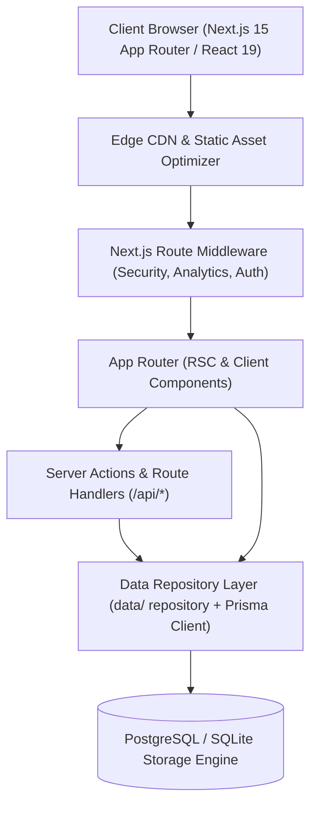
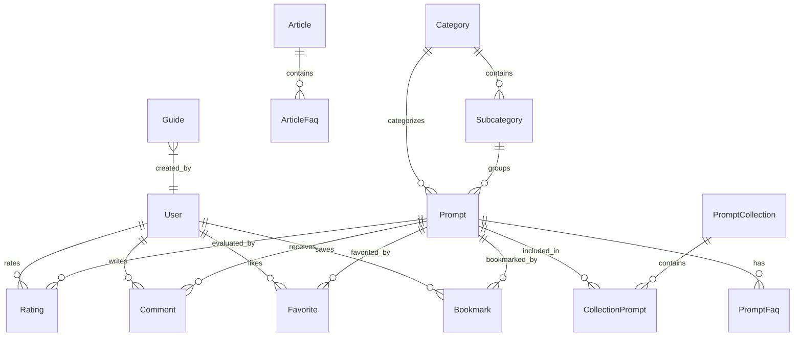

# NeonPrompt Architecture & Engineering Blueprint

## 1. High-Level System Architecture

---

## 2. Entity Relationship Diagram (ERD)

---

## 3. SEO Strategy & Technical Foundations
- **Dynamic Meta Generation:** Every category, subcategory, prompt, guide, and article dynamically synthesizes:
  - Canonical URL tags
  - Open Graph title, description, image, and type (`article`, `website`)
  - Twitter Card: `summary_large_image`
  - High-precision keyword tags
- **JSON-LD Schemas:**
  - `BreadcrumbList` on every nested page
  - `FAQPage` schema on prompt pages, FAQ directory, articles, and guides
  - `Article` and `TechArticle` schema on blog and guide entries
  - `SoftwareApplication` and `CreativeWork` schemas on prompt cards
- **Web Vitals & Performance:**
  - Zero layout shift (CLS < 0.01) with pre-allocated font sizing
  - Critical CSS inline via Tailwind CSS
  - Server-Side Rendering (SSR) and Incremental Static Regeneration (ISR)
  - Edge caching with stale-while-revalidate for search endpoints

